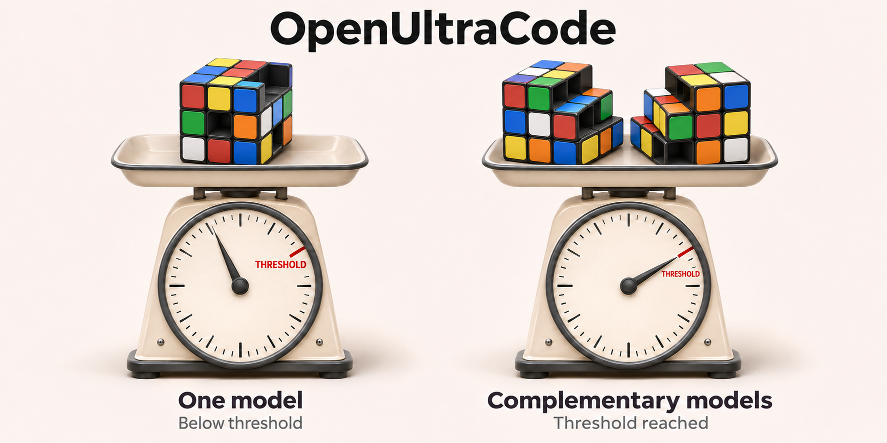

# OpenUltraCode

OpenUltraCode adds UltraCode-style workflow discipline to OpenCode 2: structured phases, adversarial review, and evidence-based completion checks on top of the opencode session you already run. It keeps the model you already selected, then adds slash commands, role agents, a skill, and a small plugin for workflow state and verification tools.

Model selection is up to you. OpenUltraCode uses no proxy and does not replace the selected model, create synthetic model IDs, or route provider traffic. Change models with opencode's normal model selection at any time; the only place OpenUltraCode names models is the opt-in fusion agents described below, and the installer's init dialogue asks you which model IDs those should use.

## Quick start

### Prerequisites

- [opencode](https://opencode.ai) is installed and on your `PATH`.
- For the development path only: Node.js 22+ and `pnpm` (the repo pins `pnpm@11.4.0` via Corepack).

### Release install (recommended)

Linux / macOS (sh):

```sh
curl -fsSL https://raw.githubusercontent.com/norandom/OpenUltraCode/main/install.sh | sh
```

Windows (PowerShell):

```powershell
irm https://raw.githubusercontent.com/norandom/OpenUltraCode/main/install.ps1 | iex
```

1. Install the latest release with `curl -fsSL https://raw.githubusercontent.com/norandom/OpenUltraCode/main/install.sh | sh`.

The installer pulls the latest GitHub release asset, copies the skill, slash commands, and agents into `~/.config/opencode/`, runs the init dialogue that asks which fusion model IDs to set, and registers the plugin package directory in the `plugins` array of `~/.config/opencode/opencode.json`. OpenCode 2 loads local plugins from directories (for example `.opencode/plugins/open-ultracode/index.ts`) via `{ "package": "<path>" }` entries, not from single `.ts` files under the V1 `plugin` key.

How the installers treat your configuration:

- Only OpenUltraCode's own entries are added or removed. Other plugins, permission rules, and settings in `opencode.json` and `opencode.jsonc` (comments, trailing commas, and a BOM are accepted) stay as they are, and a timestamped `.backup-openultracode-*` copy is written before a file changes.
- Stale OpenUltraCode entries from older releases, in either file and with forward or backslash paths, are replaced by exactly one entry, so the plugin loads once.
- The release archive is downloaded and checked next to the install directory before it replaces the old installation; a failed download or extraction leaves the working install in place. The installer refuses to replace a directory that is not an OpenUltraCode installation.
- All fusion models are chosen before any file is copied, so cancelling the menu (Ctrl+C, Esc) changes nothing. Without a terminal (CI, `--non-interactive` / `-NonInteractive`) the installed models are kept, or the shipped defaults are used.
- Every step that fails stops the installer with a non-zero exit code; it never reports success after a failed check.

Installer options: `--non-interactive`, `--panel-a`/`--panel-b`/`--decider <provider/model>`, and `--archive <file>` for an offline install from a downloaded `open-ultracode-release.tar.gz` (PowerShell: `-NonInteractive`, `-PanelA`/`-PanelB`/`-Decider`, `-Archive`). The development installers accept the same model flags. For a batch install, pass all three models with `--non-interactive`, for example:

```sh
./install.sh --non-interactive --panel-a vibe-oidc/mistral-large-4 --panel-b vibe-oidc/zai-glm-5-3 --decider vibe-oidc/mistral-large-4
```

```powershell
.\install.ps1 -NonInteractive -PanelA vibe-oidc/mistral-large-4 -PanelB vibe-oidc/zai-glm-5-3 -Decider vibe-oidc/mistral-large-4
```

Every installer ends with a summary of what is actually installed, read back from disk: the version, the registered plugin entry, the opencode config file, the three fusion models, and the installed commands and agents.

### Development install

From a checkout of this repo:

Linux / macOS:

```sh
./install-dev.sh
```

Windows (PowerShell):

```powershell
.\install-dev.ps1
```

The development installers run `pnpm install` and `pnpm run check` first (skip with `--skip-checks` / `-SkipChecks`) and stop if a check fails.

### Quality gates

`pnpm run check` is the single gate used by the pre-commit hook, CI, and the development installers. It runs offline and needs no Docker:

- asset and installer validators (`scripts/validate-assets.ts`, `scripts/validate-installers.ts`);
- `tsc`, including a contract test that type-checks the plugin against the real `@opencode/plugin` API;
- ESLint (`pnpm run lint`; the containerized Dagger run is optional as `pnpm run lint:container`);
- the test suite, including `sh`/`dash`/`shellcheck` and PowerShell 7/5.1 syntax checks for the installers and real installer runs against temporary config directories.

#### Runtime check against the real installation

Unit tests use fakes and temporary copies, so they cannot see what only a running opencode reveals: a provider missing from the running service, a model or variant opencode does not offer ("Variant unavailable for <model>: max"), or a provider answering `400 Bad Request`. `scripts/runtime-check.mjs` checks the real installation through opencode's own CLI:

- **Static (free):** `opencode api model.list` must offer the coordinator model and every installed fusion agent's provider, model, and variant.
- **Live (`--live`, a few tiny model calls):** the coordinator dispatches each installed fusion agent once through opencode's real subagent path (`opencode run --format json`); every dispatch must complete, and the exported child session (`opencode session export`) must show the configured model and variant.

Every installer finishes with `opencode reload` (so a running opencode picks up the install without a restart) and the runtime check, and fails with the problems listed if it does not pass: the release installers run the static check (`--verify` / `-Verify` adds the live check), the development installers run the live check. `--skip-runtime-check` / `-SkipRuntimeCheck` skips both. Run it any time with `pnpm run check:runtime`. Add `--directory <project>` to check a specific project folder the way opencode resolves it there: a project's own `.opencode/agents` shadow your global fusion agents. This repository keeps its shipped agents in `assets/agents`, which opencode does not load, so inside a checkout your installed agents apply. The `.githooks/pre-push` hook runs the live check before a `v*` release tag is pushed, and `OPENULTRACODE_RUNTIME=1 pnpm test` includes it in the test suite.

`pnpm install` enables the versioned `.githooks/pre-commit` hook (`core.hooksPath`). The hook refuses commits whose staged files differ from the working tree or that leave project files untracked, then runs `pnpm run check`. CI (`.github/workflows/ci.yml`) runs the same gate on Linux, macOS, and Windows with Node 22 and 24; releases run CI first. Set `OPENULTRACODE_E2E_SH=1` to also run the `sh` installers end to end on Windows.

### Restart opencode

Quit and restart opencode so the global plugin, commands, skills, and agents are loaded. opencode reads plugins, commands, skills, agents, and config only at startup, so this step is required. If `/ultracode` does not appear, first confirm you restarted opencode after running `install.sh`, `install-dev.sh`, `install.ps1`, or `install-dev.ps1`; if it still does not appear, re-run the installer and restart again.

### Install notes

- **Release installs** do not run `pnpm run check` on your machine. The GitHub Actions release workflow runs the CI gate, builds `open-ultracode-release.tar.gz` with `scripts/build-release-archive.mjs` (the single list of shipped files), and publishes it with a SHA-256 checksum as the GitHub release asset, which `install.sh` / `install.ps1` consume. Manual workflow runs are published as prereleases so they never become the latest release.
- **Development installs** use pnpm with a 3-day release-age cooldown (`minimumReleaseAge: 4320` in `pnpm-workspace.yaml`) to keep brand-new package releases out of the install path. `pnpm-workspace.yaml` allows the `esbuild` install script because the TypeScript test runner needs it.

### Removal

Every installer also removes OpenUltraCode. Removal deletes the copied skill and exactly the slash commands and agents OpenUltraCode ships (your own `ultracode-*` agents and commands stay) from `~/.config/opencode/`, removes the `{ "package": ".../.opencode/plugins/open-ultracode" }` entry and the fusion permission rule from `opencode.json` (leaving other plugins untouched), and — for release installs — deletes the downloaded release directory. Restart opencode afterwards.

Linux / macOS (sh):

```sh
curl -fsSL https://raw.githubusercontent.com/norandom/OpenUltraCode/main/install.sh | sh -s -- --remove
# or from a checkout:
./install.sh -remove        # release layout
./install-dev.sh --remove   # dev checkout (leaves the checkout in place)
```

Windows (PowerShell):

```powershell
irm https://raw.githubusercontent.com/norandom/OpenUltraCode/main/install.ps1 -OutFile install.ps1
.\install.ps1 -Remove
# or from a checkout:
.\install-dev.ps1 -Remove   # dev checkout (leaves the checkout in place)
```

## What you get

Slash commands are what you type in opencode:

- `/ultracode` for comprehensive build/review/verify work.
- `/ultracode-debug` for reproduce/root-cause/fix loops.
- `/ultracode-spec-audit` for incomplete or contradictory specs.
- `/ultracode-research` for adversarial research against a plan or claim.
- `/ultracode-verify` for evidence-based completion checks.
- `/ultracode-fusion` for explicit two-model fusion rounds with a selected decider.
- `/ultracode-fusion-models` to show or change the persistent panel and decider model IDs.
- `/ultrathink` for grounded, non-coding problem solving.
- `/ultrathink-fusion` for grounded, non-coding two-panel fusion problem solving.

The skill is named `open-ultracode`. It is not a slash command. The slash commands above tell opencode to use that skill, and opencode exposes skills to agents through its skill system rather than as `/open-ultracode`.

Supporting assets:

- Role agents for coordinator, planner, implementer, adversary, reconciler, verifier, and researcher workflows. These never pin a model; they inherit the active selected model.
- Fusion agents for panel and arbiter roles. These are intentionally separate from the normal workflow agents and are the only assets that carry a `model:` frontmatter value.
- Plugin tools for fusion model configuration, workflow status, verification evidence, blocked checks, and completion reports.

## Examples

Comprehensive task execution:

```text
/ultracode "Implement the approved registration-flow task, run the relevant tests, reconcile adversarial findings, and report completion evidence."
```

Debugging:

```text
/ultracode-debug "The docs asset test fails after adding a new command. Reproduce the failure, find the root cause, fix the smallest boundary, and verify the regression."
```

Spec audit:

```text
/ultracode-spec-audit "Review this checkout spec for missing actors, permissions, error states, and verification criteria before implementation."
```

Adversarial research:

```text
/ultracode-research "Attack this implementation plan and identify assumptions, edge cases, unsafe defaults, and evidence gaps before we build it."
```

Fusion workflow:

```text
/ultracode-fusion "Compare the two proposed API designs and produce one implementation recommendation."
```

Fusion with an arbiter agent:

```text
/ultracode-fusion --panel ultracode-fusion-panel-a --panel ultracode-fusion-panel-b --decider ultracode-fusion-arbiter "Review this migration plan and resolve disagreements with cited evidence."
```

Grounded problem solving without coding:

```text
/ultrathink "Decide whether we should keep the release installer shell-only or introduce a compiled helper. Use only the supplied constraints and call out unknowns."
```

Grounded fusion problem solving:

```text
/ultrathink-fusion "Evaluate the product tradeoff using grounded evidence, not loose recall."
```

`/ultrathink` and `/ultrathink-fusion` are not coding commands. They separate supplied facts, verified evidence, assumptions, hypotheses, and recommendations. If the problem depends on facts that are not supplied, they should ask for context or mark the point as unknown instead of drifting into loose recall.

## Fusion model selection: your choice

`/ultracode-fusion` is explicit opt-in fusion, not transparent routing for every prompt. A run has three model-bearing roles:

- The selected opencode model remains the coordinator. It gathers context, validates arguments, dispatches rounds, and reports the final trace.
- Exactly two panel agents produce and critique candidate answers. The configured panel pair is the default; repeated `--panel <agent-name>` flags can override it for one run.
- The configured fusion arbiter is the default decider. `--decider selected-model` or `--decider <fusion-arbiter-agent-name>` can override it for one run.

The default fusion concept is `critique-revise-vote`: each panel generates an answer from the same bounded context package, critiques the other panel's answer, revises its own answer, ranks the alternatives against the rubric, and then the decider arbitrates the final response.

The bundled defaults are Mistral Large 4 at its native maximum-reasoning variant, so project-local agent auto-loading works before you run the init dialogue:

- `ultracode-fusion-panel-a`: `mistral/mistral-large-4#max` (Mistral Large 4 at max reasoning).
- `ultracode-fusion-panel-b`: `mistral/mistral-large-4#max`.
- `ultracode-fusion-arbiter`: `mistral/mistral-large-4#max`.

The init dialogue in `install.sh`, `install-dev.sh`, `install.ps1`, and `install-dev.ps1` asks which model each fusion role should use. All four installers first collect the valid model IDs from your own opencode setup: everything `opencode models` reports (retried while opencode's plugins are still activating) plus the models named in your `opencode.json`/`opencode.jsonc` (`model`, `small_model`, and `provider.<id>.models`). Models of your own providers (for example your `vibe-oidc/mistral-*` models) are always listed first; opencode's hosted `opencode/*` and `opencode-go/*` catalog follows after them. The picker is a multi-column arrow-key menu that scrolls, so the full detected list is reachable. The default for every role comes from the shipped fusion agent files (Mistral Large 4 as `mistral/mistral-large-4#max`) on every installer; a role that is already installed keeps its current model as the default. The menu also offers a custom `provider/model#max` entry, for example Z.ai GLM 5.3 through the Mistral endpoint as `mistral/zai-glm-5-3#max`. When raw keyboard input is unavailable (pipes, mintty), the sh installers fall back to a numbered prompt. The chosen IDs are written into the fusion agent files' `model:` frontmatter during install. Fresh non-interactive installs use the defaults; reinstalls preserve each role's existing value. Skip the dialogue with `--panel-a`, `--panel-b`, `--decider`, and `--non-interactive` (PowerShell: `-PanelA`, `-PanelB`, `-Decider`, `-NonInteractive`).

Show the effective configuration or change any subset of the roles from opencode:

```text
/ultracode-fusion-models
/ultracode-fusion-models --panel-a mistral/mistral-large-4#max --panel-b mistral/zai-glm-5-3#max --decider mistral/mistral-large-4#max
```

The configuration command accepts `provider/model` or `provider/model#max` and changes only the effective fusion agent files. `#max` is accepted only when opencode reports a `max` variant for that model; many models declare one (for example `vibe-oidc/mistral-large-4`), others declare none (`vibe-oidc/mistral-large-latest`), and those need the plain `provider/model` reference. Non-`max` variants are rejected so they cannot lower the required effort. The tool asks for mutation permission, writes through temporary files with stale-content checks and best-effort rollback, and does not modify credentials or the selected coordinator model. opencode applies changed fusion agents to the next dispatch; restart it if a running session still uses the previous model. When a fusion role's provider, model, or variant is unavailable, the fusion run stops before dispatching that role, proposes a valid fallback from the same provider, and asks you to confirm or name another model before anything changes. Any other model ID your providers expose works too, for example `openai/gpt-5`.

All bundled fusion models expose a `max` reasoning effort and every fusion agent also sets `reasoningEffort: max`. No shared `thinking` object is injected: provider-specific thinking payloads differ across providers.

One-shot independent answers are reported as `panel-consult`, not strong fusion. Strong fusion requires the critique, revision, vote, and arbitration loop.

## Selected model preservation

OpenUltraCode inherits the active selected model from opencode. Normal bundled workflow agents do not set `model:` frontmatter, and the plugin does not install provider routes or model aliases.

Fusion agents are the deliberate exception: they use explicit `model:` frontmatter so `/ultracode-fusion` can compare two configured opencode models while the selected model remains the coordinator. This still uses opencode's native agent model selection. It is not a proxy, synthetic model ID, provider route, hidden model switch, or replacement for the selected model.

The package can add high-effort request hints through OpenCode 2's `context` session hook, which exposes semantic request options (`maxTokens`, `reasoningEffort`) per model call. The hints never lower an already-stronger effort setting and only use fields the protocol layer understands; OpenUltraCode never invents raw provider fields or claims hidden reasoning.

## Safe troubleshooting

- If commands, agents, or skills do not appear, restart opencode.
- If high-effort behavior is unsupported, check workflow status for a degradation notice.
- If a permission is denied, OpenUltraCode records the workflow as blocked and reports the safe next step.
- If completion is partial or blocked, run `/ultracode-verify` and collect fresh evidence before claiming completion.

See `docs/CONCEPTS.md`, `docs/LIMITS.md`, and `docs/CONFIGURATION.md` for workflow details.
